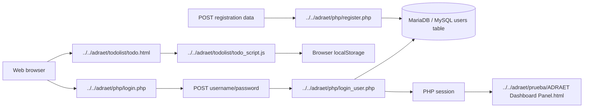

# Application architecture reconstruction

## Observed architecture

The codebase implements a traditional multi-page PHP application, not a single-page app.

### Execution model

- Browser loads static HTML pages and CSS assets.
- Login and registration forms submit via HTTP POST to PHP endpoints.
- PHP scripts call `mysqli_connect()` using credentials defined in `../../adraet/php/conexion.php`.
- The database is MariaDB/MySQL and data is returned by direct SQL queries.
- The login flow stores the username in a PHP session and redirects the browser to the dashboard HTML page.

## Verified request flow

### 1) User registration flow

Browser form in `../../adraet/php/login.php` posts to `../../adraet/php/register.php`.

- Method: `POST`
- Fields: `nombre`, `apellido`, `username`, `correo`, `telefono`, `contrasena`
- Handler: `../../adraet/php/register.php`
- Data validation: only duplicate email/username checks are performed
- Database write: `INSERT INTO users(...) VALUES(...)`

### 2) User login flow

Browser form in `../../adraet/php/login.php` posts to `../../adraet/php/login_user.php`.

- Method: `POST`
- Fields: `username`, `contrasena`
- Handler: `../../adraet/php/login_user.php`
- Query: `SELECT * FROM users WHERE username='$username' AND contrasena='$contrasena'`
- On success: `$_SESSION['usuario'] = $username` then redirect to `../prueba/ADRAET Dashboard Panel.html`
- On failure: echo `Usuario o contraseña incorrectos.`

### 3) Dashboard access flow

The dashboard page is not backed by a PHP controller. It is a static HTML file that is opened after a successful login redirect, but no server-side authorization check is present before or after the navigation.

### 4) Task flow

The to-do page in `../../adraet/todolist/todo.html` uses client-side JavaScript to:

- add tasks,
- toggle completion,
- remove tasks,
- save the HTML of the list in `localStorage`.

This is browser-only state persistence; it does not use PHP or MySQL.

## Component responsibilities

| Layer | Files | Responsibility |
| --- | --- | --- |
| Browser view | `../../adraet/php/login.php`, `../../adraet/prueba/ADRAET Dashboard Panel.html`, `../../adraet/todolist/todo.html` | Render UI |
| Browser logic | `../../adraet/js/login_script.js`, `../../adraet/todolist/todo_script.js` | Toggle forms, manage local task data |
| Server logic | `../../adraet/php/login_user.php`, `../../adraet/php/register.php` | Validate credentials, insert users |
| Database config | `../../adraet/php/conexion.php` | Connection parameters |
| Persistent storage | `../../adraet/users.sql` | Schema and initial data |

## Navigation model

The app uses traditional browser navigation with HTML links and form submissions.

- Login page toggles between login and registration panels using JS.
- Dashboard page is a direct HTML file with anchor links but no real router.
- The task page is a separate static page with localStorage persistence.

## Verified architecture diagram

## Uncertainties

- There is no evidence of a dedicated server-side routing layer or MVC structure.
- The “Dashboard” is a static mockup; no server-side dashboard data feeds were found.
- No backend files were found for inventory, contacts, scheduling, or accounting.

## Architectural conclusion

This is a legacy multi-page PHP application with minimal server-side business logic and a large amount of static front-end prototype content. It should be classified as a traditional static-UI + PHP-authentication prototype rather than a complete business platform.
