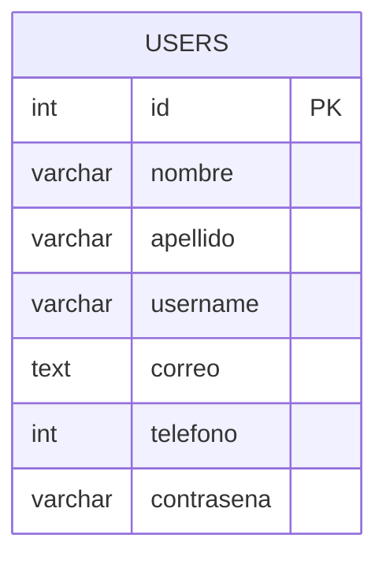

# Database audit

## Database inventory

The only database schema found is a single SQL dump in `../../adraet/users.sql`.

### Schema summary

```sql
CREATE TABLE `users` (
  `id` int(11) NOT NULL,
  `nombre` varchar(50) NOT NULL,
  `apellido` varchar(50) NOT NULL,
  `username` varchar(50) NOT NULL,
  `correo` text NOT NULL,
  `telefono` int(8) NOT NULL,
  `contrasena` varchar(50) NOT NULL
) ENGINE=InnoDB DEFAULT CHARSET=utf8mb4 COLLATE=utf8mb4_general_ci;
```

### Observed properties

- Database name: `adraet database` (note the space in the name)
- Table name: `users`
- Primary key: `id`
- Unique constraints: none explicitly declared in the dump
- Indexes: only the primary key is added via `ALTER TABLE ... ADD PRIMARY KEY (id)`
- Default values: none
- Nullable fields: none, all columns are declared `NOT NULL`
- Data type details:
  - `id`: int(11), auto-increment
  - `nombre`: varchar(50)
  - `apellido`: varchar(50)
  - `username`: varchar(50)
  - `correo`: text
  - `telefono`: int(8)
  - `contrasena`: varchar(50)

## SQL query map

| SQL operation | Source file | Query pattern | Table involved |
| --- | --- | --- | --- |
| Login check | `../../adraet/php/login_user.php` | `SELECT * FROM users WHERE username='$username' AND contrasena='$contrasena'` | `users` |
| User duplicate check | `../../adraet/php/register.php` | `SELECT * FROM users WHERE correo='$correo'` | `users` |
| Username duplicate check | `../../adraet/php/register.php` | `SELECT * FROM users WHERE username='$username'` | `users` |
| New user insert | `../../adraet/php/register.php` | `INSERT INTO users(nombre,apellido,username,correo,telefono,contrasena) VALUES(...)` | `users` |

## Data integrity findings

- The schema does not enforce uniqueness on `username` or `correo` at the database level.
- The application handles duplicate checks in PHP before insert, but those checks are not backed by unique constraints.
- `telefono` is stored as an integer and the schema does not enforce a valid phone-length or format rule.
- `contrasena` is stored as a `varchar(50)` without hashing or salting, and the SQL logic compares it directly in a `WHERE` clause.
- There are no foreign keys, no transactional wrappers, and no explicit integrity rules beyond the primary key.

## Relationship model

Only one table exists. There are no foreign keys or relational joins in the examined source.



## SQL security review

- Input is directly concatenated into SQL strings in both login and registration handlers.
- There is no prepared statement usage (`mysqli_prepare`, parameter binding, or PDO prepared statements).
- The project does not separate config from code beyond placing constants in `conexion.php`.
- Error handling is minimal and only prints generic connection messages or alerts to the browser.

## Seed data and privacy

The SQL dump includes sample rows with names, emails, usernames, phone numbers, and plaintext passwords. This sample data is not reproduced in this report; it was left redacted as a privacy safeguard.

## Assessment

The database layer is extremely thin. It provides a single user table for authentication and registration, but it does not implement a secure or fully normalized business data model. The schema is sufficient for the prototype but not for real-world business operations.
