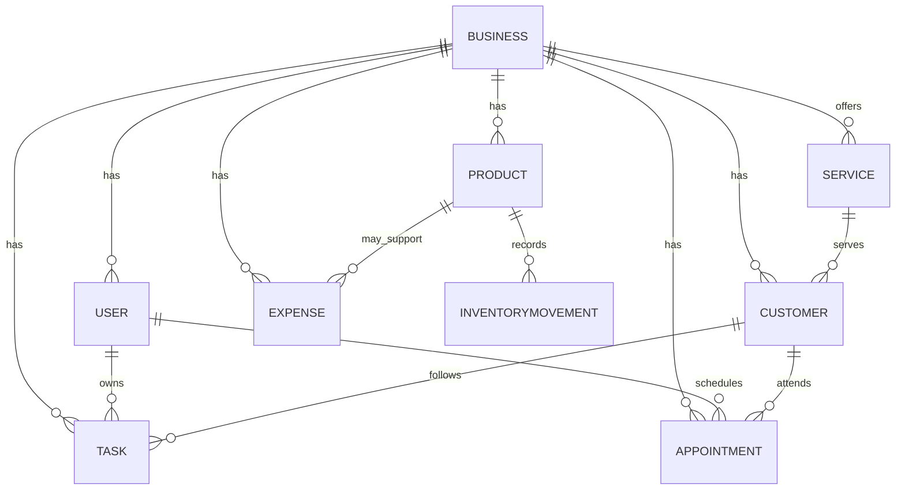

# DOMAIN MODEL

## Decision labels

- VERIFIED FACT: Observed in the repository and legacy audit.
- PROPOSED DESIGN: Proposed conceptual model for next-stage planning.
- OPEN QUESTION: Needs approval or domain clarification.
- ASSUMPTION: Working assumption until confirmed.

## 1) Scope and principles

- VERIFIED FACT: The repository includes only a `users` table and a static dashboard; there is no verified business domain schema yet.
- PROPOSED DESIGN: The domain model must remain conceptual until product and business requirements are validated.
- ASSUMPTION: The MVP should not include every possible business entity at once.

## 2) Core conceptual entities

### User
- PROPOSED DESIGN: A person with login access and a profile.
- Attributes: id, email, username, password hash, createdAt, status, role
- Relationships: many users may belong to one business; one user may own or manage multiple businesses in a future model

### Business
- PROPOSED DESIGN: The operational unit being managed.
- Attributes: id, name, industry, location, status, createdAt
- Relationships: one business may have many users, many tasks, many customers, many products, many expenses

### Customer
- PROPOSED DESIGN: A party that buys products or services from a business.
- Attributes: id, businessId, name, contact info, notes, leadStatus
- Relationships: may be linked to appointments, tasks, and orders or service interactions

### Appointment
- PROPOSED DESIGN: A time-based record for meetings or scheduled follow-ups.
- Attributes: id, businessId, title, dateTime, assignedUserId, customerId, notes
- Relationships: belongs to a business and optionally to a customer and task owner

### Task
- PROPOSED DESIGN: An action item that requires follow-through.
- Attributes: id, businessId, title, description, status, dueDate, assigneeId
- Relationships: belongs to a business and may be linked to a customer or appointment

### Product
- PROPOSED DESIGN: An item sold or used by the business.
- Attributes: id, businessId, name, category, sku, unitCost, salePrice, stockQuantity
- Relationships: associated with inventory movements and possibly expenses or materials

### InventoryMovement
- PROPOSED DESIGN: A stock ledger entry for product changes.
- Attributes: id, productId, movementType, quantity, relatedReference, createdAt
- Relationships: tied to product and sometimes to purchase or sale operations

### Expense
- PROPOSED DESIGN: A cost record not tied only to payroll or inventory.
- Attributes: id, businessId, category, description, amount, date
- Relationships: may be connected to materials or products

### Service
- PROPOSED DESIGN: A non-physical offering that the business sells.
- Attributes: id, businessId, name, description, price, scheduleType
- Relationships: may be connected to customers and appointments

## 3) Candidate MVP entity set

- PROPOSED DESIGN: The initial useful slice likely includes:
  - User
  - Business
  - Task
  - Appointment
  - Customer
  - Product
  - Expense
  - InventoryMovement
- OPEN QUESTION: Should services be included in the MVP, or should they be modeled as a product-like offering later?

## 4) Relationships

## 5) Unresolved business rules

- OPEN QUESTION: Is each user tied to exactly one business, or can a user manage multiple businesses?
- OPEN QUESTION: Are tasks only personal, or can they be assigned to teams and statuses?
- OPEN QUESTION: Are appointments strictly customer-linked, or can they be internal operations as well?
- OPEN QUESTION: Is inventory tracked by product only, or are raw materials also tracked as distinct items?
- OPEN QUESTION: Should expense tracking begin as simple categories or as full cost accounting?
- OPEN QUESTION: Are analytics based on sales, stock movement, or both?

## 6) Distinction: conceptual entities vs database schema

- VERIFIED FACT: The repository only supports a single `users` table.
- PROPOSED DESIGN: The entities above are conceptual; they should not be treated as approved schema until product validation and normalized design are complete.
- ASSUMPTION: A future database schema must be approved by product and business rules before implementation.

## 7) Concluding principle

- PROPOSED DESIGN: The domain model should grow from the validated product scope, not from the static dashboard labels alone.
- VERIFIED FACT: The dashboard text suggests several domains, but the repository does not support them as implemented features.
